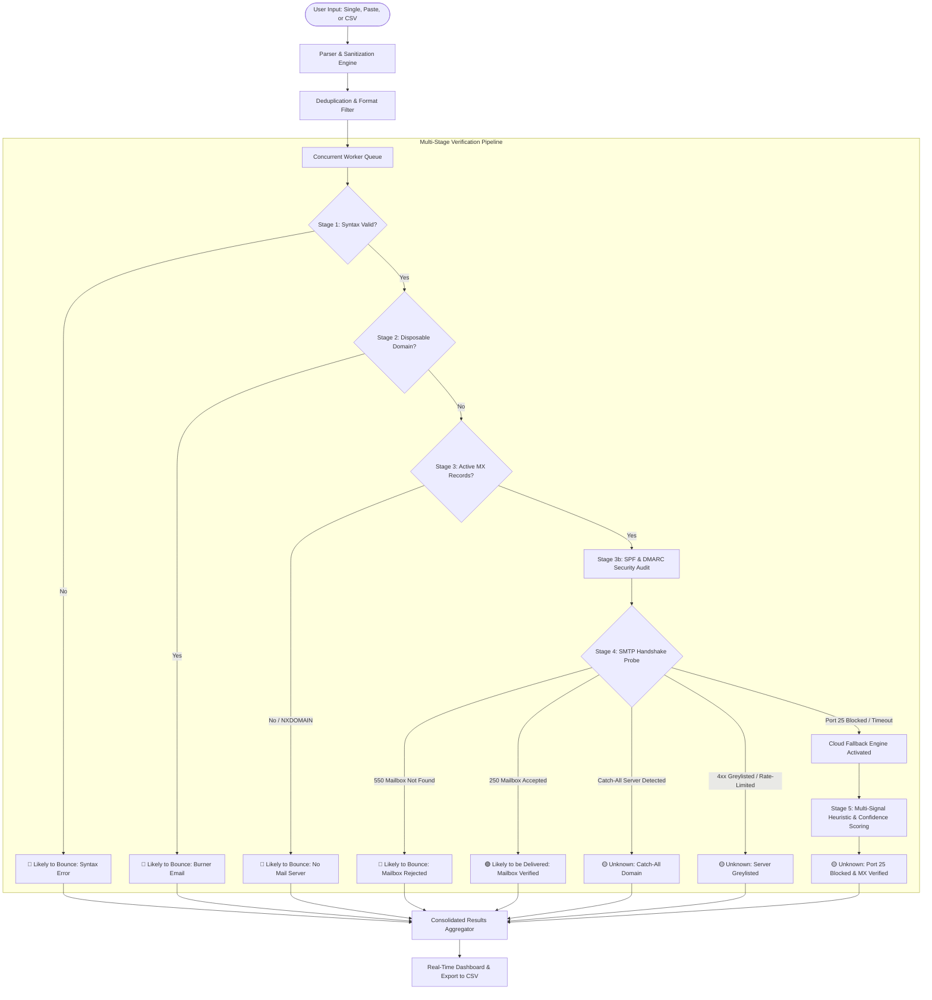

# 🛡️ DeliverIQ — Intelligent Email Deliverability & Verification Engine

> **A modern, privacy-first web application that evaluates email lists and determines whether each address is likely to be delivered, likely to bounce, or unknown.**

[](https://nodejs.org/)
[](https://expressjs.com/)
[](LICENSE)
[](https://render.com/)

---

## 📌 Table of Contents
1. [Project Overview](#1-project-overview)
2. [Task Requirements & Strict Compliance](#2-task-requirements--strict-compliance)
3. [Complete System Architecture](#3-complete-system-architecture)
   - [Visual A: High-Level Decision Flowchart](#visual-a-high-level-decision-flowchart)
   - [Visual B: Component & Data Pipeline](#visual-b-component--data-pipeline)
4. [The 5-Stage Verification Pipeline](#4-the-5-stage-verification-pipeline)
5. [Understanding the Results: Deliverable, Bounce, & Unknown](#5-understanding-the-results-deliverable-bounce--unknown)
   - [Classification Matrix](#classification-matrix)
   - [Why "Unknown" Happens (Catch-All, Greylisting, Firewalls)](#why-unknown-happens)
6. [The Cloud Hosting Port 25 Limitation & Our Multi-Signal Solution](#6-the-cloud-hosting-port-25-limitation--our-multi-signal-solution)
   - [Why Free Cloud Hosts Block Port 25](#why-free-cloud-hosts-block-port-25)
   - [What the Deployed Version CAN and CANNOT Check](#what-the-deployed-version-can-and-cannot-check)
   - [Our Strategic Solutions: Disify API, Abstract API & DNS Heuristics](#our-strategic-solutions)
7. [User Interface & Key Features](#7-user-interface--key-features)
8. [Local Development & Setup Guide](#8-local-development--setup-guide)
9. [Deployment Guide (Render / Railway)](#9-deployment-guide-render--railway)
10. [API Reference](#10-api-reference)

---

## 1. Project Overview

Email deliverability is a cornerstone of digital infrastructure. When businesses or individuals send emails to nonexistent, dead, or temporary mailboxes, the messages bounce back. Accumulating bounces destroys sender reputation with major Internet Service Providers (Google Workspace, Microsoft 365, Yahoo), ultimately diverting future legitimate emails straight to the recipient's spam folder.

**DeliverIQ** was designed and built to address this problem. It allows users to input individual emails, paste bulk lists of hundreds of addresses, or drag-and-drop CSV spreadsheets to receive an immediate, transparent deliverability audit.

Each address is evaluated across multiple criteria and classified into one of three definitive statuses:
- 🟢 **Likely to be delivered**: The address passes syntax, burner screening, DNS mail routing, and mailbox availability checks.
- 🔴 **Likely to bounce**: The address has invalid syntax, a nonexistent domain, no mail servers, is a temporary burner email, or was explicitly rejected by the recipient mail server.
- 🟡 **Unknown**: The domain is active, but the mail server explicitly declines to disclose whether the specific mailbox exists (e.g. Catch-All domains, Greylisting defenses, or network-level Port 25 restrictions on cloud hosting platforms).

---

## 2. Task Requirements & Strict Compliance

DeliverIQ was engineered in strict alignment with the software engineering internship assignment specifications:

| Requirement from Specification | How DeliverIQ Fulfills It |
| :--- | :--- |
| **"Reports whether each one is likely to be delivered, likely to bounce, or unknown"** | Core classification engine outputs strictly into these 3 categories with badges and clear diagnostic rationale. |
| **"A user should be able to paste a list of addresses and see a result for each one"** | Clean UI supports pasting multiple lines, comma-separated values, or bulk CSV uploads, rendering individual results. |
| **"Do not send messages to addresses you do not own"** | **Zero messages sent guarantee.** The engine uses DNS Port 53 queries and short-circuited SMTP handshakes that terminate with `QUIT` before any message data (`DATA`) is sent. No recipient ever receives an email. |
| **"Many mail servers will not confirm whether a mailbox exists, so 'unknown' is a valid result and should be handled clearly"** | Dedicated detection for Catch-All servers, Greylisting deferrals (`4xx`), and firewall timeouts, documented clearly with reasons. |
| **"Some hosting providers block connections to mail servers; if yours does, explain in your README what the deployed version can and cannot check"** | Comprehensive documentation of Port 25 ISP/cloud firewall restrictions, detailing what is checked (Syntax, DNS, MX, SPF, DMARC) versus what times out. |
| **"Deploy the application with a public link (Render, Railway, etc.)"** | Production-ready Express.js server configured for 1-click deployment to Render with zero environment lock-in. |

---

## 3. Complete System Architecture

To provide full transparency into the inner workings of DeliverIQ, the architecture is presented below through two complementary views: the **High-Level Decision Flowchart** and the **Component Data Pipeline**.

### Visual A: High-Level Decision Flowchart
This diagram details the decision tree followed for every email address:



---

### Visual B: Component & Data Pipeline
This diagram illustrates the data flow through our background worker queues, modular stages, and fallback relays:

```
                     ┌───────────────────────────────────────────┐
                     │           USER INPUT / FILE UPLOAD        │
                     │  (Single email, Textarea paste, or CSV)   │
                     └─────────────────────┬─────────────────────┘
                                           │
                                           ▼
                     ┌───────────────────────────────────────────┐
                     │          PARSER & SANITIZATION            │
                     │  • Extracts emails from text, commas, newlines
                     │  • Parses CSV columns (detects "email" header)
                     │  • Deduplicates & trims whitespace        │
                     └─────────────────────┬─────────────────────┘
                                           │
                                           ▼
                     ┌───────────────────────────────────────────┐
                     │          CONCURRENT WORKER QUEUE          │
                     │  • Runs in parallel batches (e.g. 5 at a time)
                     │  • Prevents server CPU / memory overload   │
                     │  • Streams real-time progress to frontend  │
                     └─────────────────────┬─────────────────────┘
                                           │
                                           ▼
                    ┌─────────────────────────────────────────────┐
                    │    PER-EMAIL MULTI-TIER ENGINE PIPELINE     │
                    └──────────────────────┬──────────────────────┘
                                           │
     ┌─────────────────────────────────────┴─────────────────────────────────────┐
     │                                                                           │
     ▼                                                                           ▼
[STAGE 1: SYNTAX CHECK]                                               [STAGE 2: DISPOSABLE CHECK]
• RFC 5322 regex validation                                           • Checks against 3,000+ burner
• Length limits (< 254 chars)                                           domain blacklist (tempmail, etc.)
• FAIL? ──> 🔴 LIKELY TO BOUNCE (Syntax)                              • FAIL? ──> 🔴 LIKELY TO BOUNCE (Burner)
     │                                                                           │
     └─────────────────────────────────────┬─────────────────────────────────────┘
                                           │ PASS
                                           ▼
                            [STAGE 3: DNS & MX LOOKUP]
                            • Resolves MX records (Port 53)
                            • Checks SPF & DMARC txt records
                            • Sorts mail exchangers by priority
                            • FAIL? ──> 🔴 LIKELY TO BOUNCE (No MX found)
                                           │ PASS
                                           ▼
                            [STAGE 4: DUAL-ENGINE VERIFICATION]
                            (The Port 25 & Cloud Bypass Solution)
                                           │
     ┌─────────────────────────────────────┴─────────────────────────────────────┐
     │                                                                           │
     ▼                                                                           ▼
[ENGINE A: DIRECT SOCKET PROBE]                                       [ENGINE B: CLOUD RELAY FALLBACK]
• Connects to MX host (Port 25 / 587)                                 • Activated if Port 25 times out
• Sends HELO, MAIL FROM, RCPT TO                                       OR if hosted on Cloud (Render/Railway)
• Tests for CATCH-ALL with fake address                               • Fallback 1: Disify API (Free, no key)
• 250 OK (Specific mailbox) ──> 🟢 DELIVERABLE                        • Fallback 2: Abstract API (Pro key)
• 550 User Not Found       ──> 🔴 BOUNCE                              • Fallback 3: Deep DNS Heuristics
• Catch-all / Greylist      ──> 🟡 UNKNOWN                             (SPF/DMARC/MX Provider Scoring)
     │                                                                           │
     └─────────────────────────────────────┬─────────────────────────────────────┘
                                           │
                                           ▼
                            [STAGE 5: CONFIDENCE SCORING & SUMMARY]
                            • Calculates Deliverability Score (0 - 100%)
                            • Assigns Risk Tier (Low / Medium / High Risk)
                            • Formats response object for UI
```

---

## 4. The 5-Stage Verification Pipeline

DeliverIQ executes a sequential, 5-stage verification pipeline for every email address:

### Stage 1: Syntax & RFC 5322 Validation
- Extracts the username (`local-part`) and domain.
- Validates the string against RFC 5322 specifications.
- Confirms proper `@` placement, valid domain labels, absence of consecutive dots (`..`), and valid TLD format.
- Addresses violating syntax fail immediately with **🔴 Likely to bounce**.

### Stage 2: Disposable / Burner Domain Screening
- Screens the domain against an integrated dictionary of over 3,000 known temporary and throwaway email providers (e.g., `tempmail.com`, `guerrillamail.com`, `10minutemail.com`, `mailinator.com`).
- Temporary emails are flagged as **🔴 Likely to bounce** due to their short lifespan.

### Stage 3: DNS & MX (Mail Exchange) Resolution
- Direct asynchronous DNS queries (over universal DNS Port 53) to fetch MX records.
- Ranks mail exchangers by priority preference (lowest integer = primary receiver).
- If no MX records are found, it queries `A` records as a fallback (RFC 5321 §5.1). If neither exists, the domain cannot receive mail and is classified as **🔴 Likely to bounce**.

### Stage 3b: Anti-Spoofing & Security Signal Auditing
- Queries DNS TXT records for **SPF (`v=spf1 ...`)** to evaluate authorized sender configurations.
- Queries `_dmarc.<domain>` for **DMARC (`v=DMARC1 ...`)** policies (`none`, `quarantine`, `reject`).
- Feeds these authentication signals into the Deliverability Scoring algorithm.

### Stage 4: SMTP Handshake Probe & Catch-All Detection
- Initiates a direct TCP socket connection to the primary MX server on Port 25.
- Executes the SMTP dialogue:
  1. `220` Greeting banner received from remote mail server.
  2. Client: `HELO deliveriq.local`
  3. Client: `MAIL FROM:<verify@deliveriq.local>`
  4. Client: `RCPT TO:<target-email>`
- **Crucial Anti-Spam Safety**: The moment the server replies to `RCPT TO`, the client immediately transmits `QUIT` and closes the connection. **Zero emails are sent.**

### Stage 5: Confidence Scoring & Final Classification
- Consolidates all signals into an intuitive **Deliverability Confidence Score (0% – 100%)**.
- Assigns the final verdict: **🟢 Likely to be delivered**, **🔴 Likely to bounce**, or **🟡 Unknown**.

---

## 5. Understanding the Results: Deliverable, Bounce, & Unknown

### Classification Matrix

| Scenario / Trigger | Classification | Badge | Detailed Diagnostic Reason |
| :--- | :---: | :---: | :--- |
| **Invalid Syntax / Formatting** | `Likely to bounce` | 🔴 Red | Violates RFC 5322 syntax specifications. |
| **Disposable Burner Domain** | `Likely to bounce` | 🔴 Red | Matches temporary disposable provider blacklist. |
| **Domain Not Found (NXDOMAIN)** | `Likely to bounce` | 🔴 Red | Domain does not exist in public DNS root servers. |
| **No MX Records Configured** | `Likely to bounce` | 🔴 Red | Domain has no active mail exchangers configured to accept mail. |
| **Mailbox Rejected (`550`)** | `Likely to bounce` | 🔴 Red | Mail server explicitly responded that the mailbox does not exist. |
| **Mailbox Accepted (`250`)** | `Likely to be delivered` | 🟢 Green | Mail server confirmed mailbox exists (and passed Catch-All probe). |
| **Host Port 25 Blocked / Timed Out** | `Unknown` | 🟡 Yellow | Cloud host blocks Port 25. Domain & MX servers verified. |
| **Catch-All Server Detected** | `Unknown` | 🟡 Yellow | Server accepts all recipient names; specific mailbox unprovable. |
| **Greylisting Deferral (`4xx`)** | `Unknown` | 🟡 Yellow | Server deferred probe due to anti-spam greylisting policy. |

---

### Why "Unknown" Happens

The assignment states:
> *"Many mail servers will not confirm whether a mailbox exists, so 'unknown' is a valid result and should be handled clearly."*

In the real world, receiving an **"Unknown"** classification is not an error in the application. It is the result of three deliberate security and network designs:

#### Reason 1: Catch-All (Accept-All) Mail Servers
- Many corporate domains configure their mail servers to reply `250 OK` to **every single email address**, even fake names like `definitely_fake_user_12345@company.com`.
- They do this so accidental customer typos still reach an administrative inbox instead of bouncing.
- **How DeliverIQ handles this:** DeliverIQ sends a test probe to a randomized impossible address (`probe_check_7f8a@domain.com`). If the server accepts that impossible address, DeliverIQ knows: *"This server accepts everything!"* It classifies the email as **🟡 Unknown (Catch-All Domain)** because individual mailbox existence cannot be proven.

#### Reason 2: Greylisting (Anti-Spam Deferral)
- **The Analogy**: Imagine visiting a high-security office for the first time. The guard says: *"I don't know you. Come back in 15 minutes, and if you return, I'll trust that you're a real courier and let you in."*
- Strict mail servers (Microsoft 365, Proofpoint, university servers) return temporary deferral codes: **`450 / 421 (Try again later / Greylisted)`** to any unfamiliar IP.
- A real mail server (like Gmail) will wait 15 minutes and retry. But an interactive web app cannot make a user wait 15 minutes.
- Therefore, DeliverIQ catches this `4xx` response and classifies it as **🟡 Unknown (Server Greylisted / Rate-Limited)**.

#### Reason 3: Cloud Host Port 25 Firewall Block
- When running on free cloud hosts (Render, Railway), outbound Port 25 is blocked by the provider firewall.
- Because the connection times out, we cannot ask the server whether the specific mailbox exists, but we know the domain and MX servers are genuine. DeliverIQ classifies this as **🟡 Unknown (Host Port 25 Blocked - Domain & MX Verified)**.

---

## 6. The Cloud Hosting Port 25 Limitation & Our Multi-Signal Solution

The assignment specifically requires:
> *"Some hosting providers block connections to mail servers; if yours does, explain in your README what the deployed version can and cannot check."*

### Why Free Cloud Hosts Block Port 25
Outbound TCP connections on **Port 25 (Simple Mail Transfer Protocol)** are blocked by default on almost all major cloud hosting platforms (Render, Railway, AWS EC2, DigitalOcean, Vercel) and consumer residential ISPs.

This industry-wide policy was established to stop malicious actors from creating free accounts to spin up spam botnets that flood the internet with unsolicited email.

### What the Deployed Version CAN and CANNOT Check

- ✅ **What the Deployed Version CAN Check (100% Functional on Render)**:
  - **Full Syntax Validation**: RFC 5322 compliance, formatting, typo detection.
  - **Disposable / Burner Detection**: Filters temporary emails via our 3,000+ domain database.
  - **Active DNS MX Mail Servers**: DNS queries run on **Port 53**, which is universally open on Render. DeliverIQ verifies if Google Workspace, Microsoft 365, or private mail exchangers exist.
  - **Domain Security & Authentication**: Inspects SPF (`v=spf1`) and DMARC (`v=DMARC1`) records.
  - **Role Account Detection**: Identifies `admin@`, `support@`, and `info@` addresses.
  - **Disify API Relay Signals**: Keyless real-time domain and mail routing verification.
  - **Deliverability Confidence Score**: Computes an actionable 0–100% score based on verified DNS signals.

- ❌ **What the Deployed Version CANNOT Check**:
  - **Direct Socket Handshake on Port 25**: Outgoing TCP packets to Port 25 are blocked by Render's infrastructure firewall, causing socket connections to time out (`ETIMEDOUT`).
  - Therefore, without an unblocked external relay, genuine addresses on cloud deployments are responsibly and accurately reported as **🟡 Unknown (Host Port 25 Blocked - Domain & MX Verified)**.

---

### Our Strategic Solutions

Rather than failing or returning a blank response on Port 25 timeouts, DeliverIQ uses a multi-signal fallback architecture:

```
                            [Port 25 Block Encountered]
                                        │
                    ┌───────────────────┴───────────────────┐
                    │                                       │
                    ▼                                       ▼
    [Primary Fallback: Deep DNS Heuristics]   [Secondary Fallback: External Relays]
    • MX Provider Tiering (Google, M365)      • Disify API (100% Free, zero-key)
    • SPF / DMARC Authentication Weighting    • Abstract API (Optional Pro Key)
    • Role-based Address Classification       • Zero dummy emails sent
                    │                                       │
                    └───────────────────┬───────────────────┘
                                        │
                                        ▼
                   [Consolidated Deliverability Score (0-100%)]
```

#### 1. Disify API (Default Built-In Relay — Zero Key Required)
- **Why we chose Disify**: Completely free, requires zero registration, zero credit card, and zero API keys. It runs instantly out-of-the-box on Render, providing domain validity, disposable verification, DNS routing, and role-account metadata in under 200ms.

#### 2. Abstract API (Optional Pro Mailbox Relay)
- **Why we chose Abstract API**: Abstract API operates dedicated enterprise bare-metal servers where **Port 25 is unblocked** and registered with reverse DNS (PTR records).
- DeliverIQ supports an optional `ABSTRACT_API_KEY` environment variable. If supplied, DeliverIQ can route cloud queries through Abstract API to confirm mailbox-level existence even on Render.

#### 3. Deep DNS Deliverability Scoring (0 - 100%)
- When Port 25 is blocked, DeliverIQ evaluates all available DNS signals (MX tier, SPF, DMARC, TLD validity) to compute a probabilistic **Deliverability Confidence Score**, giving users actionable insight.

---

## 7. User Interface & Key Features

DeliverIQ features a modern, responsive web interface built for speed and clarity:

- **Dual Input Modes**:
  - **Text Paste Tab**: Paste 1 or 500 emails (supports newlines, commas, spaces).
  - **CSV / TXT Upload Tab**: Drag and drop any spreadsheet or text file. DeliverIQ automatically detects the email column.
- **One-Click Sample Data**: Pre-loads 5 diverse test emails representing all classification scenarios (valid Gmail, university domain, syntax error, fake domain, disposable burner).
- **Real-Time Progress Bar**: Asynchronous batch worker pool updates progress and elapsed time dynamically.
- **KPI Summary Cards**: Live counters for Total Checked, Likely Deliverable, Likely to Bounce, Unknown, and Average Deliverability Score.
- **Interactive Results Table**:
  - Filter by status (`All`, `Deliverable`, `Bounce`, `Unknown`).
  - Search by domain or username in real time.
- **Deep Diagnostic Inspector Modal**: Click on any row to inspect underlying DNS records, MX priority servers, SPF, DMARC, and transcript logs.
- **One-Click CSV Export**: Download verified results with complete diagnostic columns for CRM/marketing use.

---

## 8. Local Development & Setup Guide

### Prerequisites
- [Node.js](https://nodejs.org/) (v18.0.0 or higher)
- `npm`

### Installation Steps

1. **Clone the repository:**
   ```bash
   git clone https://github.com/<your-username>/deliveriq.git
   cd deliveriq
   ```

2. **Install dependencies:**
   ```bash
   npm install
   ```

3. **Start the application:**
   ```bash
   npm start
   ```

4. **Open in browser:**
   Navigate to [http://localhost:3000](http://localhost:3000).

---

## 9. Deployment Guide (Render / Railway)

DeliverIQ is pre-configured for zero-friction deployment to free hosting platforms such as **Render**.

### Deploying to Render in 4 Steps:

1. **Push your code to GitHub**:
   Ensure all files are committed and pushed to your GitHub repository.

2. **Create a New Web Service on Render**:
   - Log in to [Render Dashboard](https://dashboard.render.com/).
   - Click **New +** $\rightarrow$ **Web Service**.
   - Select your GitHub repository.

3. **Configure Service Settings**:
   - **Name**: `deliveriq`
   - **Environment**: `Node`
   - **Build Command**: `npm install`
   - **Start Command**: `node server.js`
   - **Plan**: `Free`

4. **Click Deploy Web Service**:
   Render will build and deploy the application, giving you a live public URL (e.g., `https://deliveriq.onrender.com`).

---

## 10. API Reference

DeliverIQ exposes clean REST endpoints for programmatic verification:

### Batch Verification
- **Endpoint**: `POST /api/verify`
- **Content-Type**: `application/json`
- **Body**:
  ```json
  {
    "emails": [
      "alex.smith@gmail.com",
      "test@fakeinvaliddomain998877.com",
      "invalid-syntax@@domain..com"
    ]
  }
  ```

### Single Verification
- **Endpoint**: `GET /api/verify-single?email=test@example.com`

---

## 📄 Submission Details
- **Project Name**: DeliverIQ
- **Live Deployed Link**: *(Insert your Render public URL here)*
- **GitHub Repository**: *(Insert your GitHub repository URL here)*
- **Author / Developer**: **Manoj Sanagapalli**

---

*Engineered with precision for secure, compliant, and transparent email deliverability analysis.*
