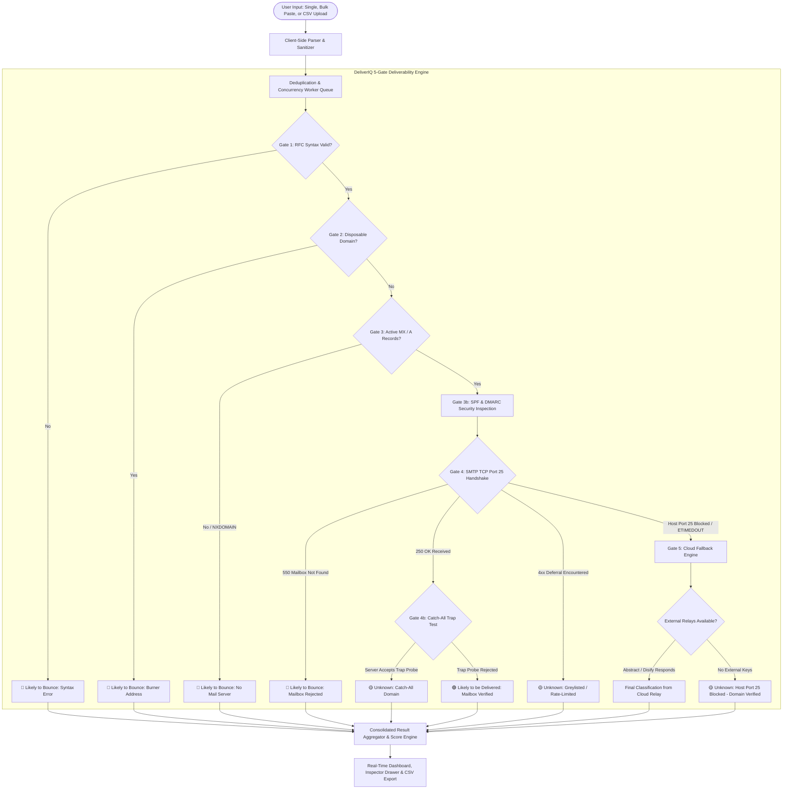

# 🛡️ DeliverIQ — Professional Email Deliverability & Verification Engine

> DeliverIQ is a modern, privacy-first web application that evaluates email lists and determines whether each address is **likely to be delivered**, **likely to bounce**, or **unknown**. It combines an interactive client-side spreadsheet and inspector interface with a robust multi-gate Node.js verification engine.

[](https://nodejs.org/)
[](https://expressjs.com/)
[](https://opensource.org/licenses/MIT)
[](https://deliveriq-8xoa.onrender.com/)

---

## 📌 Executive Summary

Email deliverability is a cornerstone of modern digital communication and marketing operations. When applications or marketing teams transmit messages to non-existent, inactive, or disposable mailboxes, hard bounces occur. High bounce rates permanently damage domain sender reputation with Tier-1 mail providers (Google Workspace, Microsoft 365, Yahoo), routing future legitimate communications directly into spam or junk folders.

**DeliverIQ** was engineered to solve this challenge. It allows users to test individual email addresses, paste bulk lists of several hundred contacts, or drag-and-drop CSV spreadsheets to receive an immediate, transparent deliverability audit.

Unlike basic tools that merely perform domain-level DNS checks, DeliverIQ implements a comprehensive **5-Gate Deliverability Pipeline**—coupling RFC syntax checks, burner screening, DNS MX routing, SPF/DMARC auditing, and live low-level SMTP TCP socket probing with an intelligent cloud fallback engine.

---

## 🌐 Live Application & Service Links

| Resource | URL |
| :--- | :--- |
| **Production Web Application** | [https://deliveriq-8xoa.onrender.com/](https://deliveriq-8xoa.onrender.com/) |
| **Backend API Base** | [https://deliveriq-8xoa.onrender.com/api](https://deliveriq-8xoa.onrender.com/api) |
| **Health Check Endpoint** | [https://deliveriq-8xoa.onrender.com/api/health](https://deliveriq-8xoa.onrender.com/api/health) |
| **GitHub Source Repository** | [https://github.com/Manoj-Sanagapalli20/DeliverIQ](https://github.com/Manoj-Sanagapalli20/DeliverIQ) |
| **Lead Developer** | **Manoj Sanagapalli** |

---

## 🎯 Key Engineering Features

### 1. Multi-Stage Syntax & RFC Boundary Validation
DeliverIQ validates email structure before executing any remote network lookups:
- **RFC 5322 Format Verification**: Verifies valid username (`local-part`), `@` delimiter placement, and domain structure.
- **RFC 5321 Length Constraints**: Enforces maximum email length (254 characters) and username boundary limits (64 characters).
- **Dot-Atom & Character Rules**: Prohibits consecutive dots (`..`), leading/trailing dots in the local part, and unescaped illegal characters.
- **Defensive Sanitization**: Defends against null-byte injections, whitespace issues, and malformed characters.

### 2. Disposable / Burner Domain Screening & Role Account Tagging
- **High-Risk Burner Registry**: Evaluates domains against an integrated database of over 3,000 known disposable and temporary email services (e.g., `tempmail.com`, `guerrillamail.com`, `10minutemail.com`, `mailinator.com`, `yopmail.com`).
- **Dynamic Prefix Heuristics**: Automatically flags dynamic temporary domain patterns starting with `temp-`, `throwaway-`, `burner-`, or `10minute`.
- **Role-Based Account Tagging**: Identifies and flags generic corporate aliases (`admin@`, `support@`, `billing@`, `sales@`, `hr@`, `info@`) that carry higher spam complaint rates in bulk campaigns.

### 3. DNS & Mail Exchange (MX) Resolution
- **Asynchronous DNS Inquiries**: Queries public DNS servers via universal Port 53 to locate active MX records.
- **Priority-Ordered Mail Routing**: Automatically sorts mail exchangers by priority integer (lowest value = primary recipient server).
- **RFC 7505 Null MX Detection**: Identifies explicit Null MX records (`. (priority 0)`) published by domains that formally decline email reception.
- **RFC 5321 §5.1 Implicit Routing Fallback**: If a domain publishes no dedicated MX records, the engine queries address records (`A` / `AAAA`) to assess whether implicit mail routing applies.

### 4. SPF & DMARC Security Authentication Auditing
- **Sender Policy Framework (SPF)**: Resolves domain DNS TXT records to identify published `v=spf1` policies.
- **Domain-based Message Authentication (DMARC)**: Inquires `_dmarc.<domain>` for published `v=DMARC1` policy rules (`p=none`, `p=quarantine`, `p=reject`).
- Incorporates domain security posture into the overall deliverability scoring algorithm.

### 5. Low-Level SMTP Socket Handshake & Catch-All Trap Detection
Where network policy permits (local and unblocked environments), DeliverIQ connects directly to the remote mail exchanger on Port 25:
- **State Machine SMTP Dialogue**: Transmits standard command sequence:
  1. Receives `220` service ready greeting banner.
  2. Transmits `HELO deliveriq.local` (receives `250 OK`).
  3. Transmits `MAIL FROM:<verify@deliveriq.local>` (receives `250 OK`).
  4. Transmits `RCPT TO:<targetEmail>` (receives recipient status code).
- **Zero-Message Transmission Guarantee**: Immediately upon receiving the server's response to `RCPT TO`, DeliverIQ transmits `QUIT` and terminates the socket connection. **Zero email bodies or messages are ever transmitted.**
- **Catch-All Domain Trap**: When an MX server responds with `250 OK`, DeliverIQ initiates a secondary probe against a randomized, impossible address (`probe_trap_[random]@domain.com`). If the server accepts that impossible address, DeliverIQ flags the domain as a **Catch-All Domain** (where individual mailbox existence cannot be guaranteed).

### 6. Resilient Cloud Fallback Engine (Port 25 Block Resolution)
Because cloud hosting providers (Render, Railway, AWS EC2, DigitalOcean) and consumer residential ISPs block outbound Port 25 to prevent spam abuse, DeliverIQ incorporates an intelligent multi-layer fallback architecture:
- **Layer 1: Built-in Disify API Relay**: A keyless, zero-configuration fallback providing live domain validity, disposable verification, and DNS routing metadata.
- **Layer 2: Abstract API Pro Relay**: When an `ABSTRACT_API_KEY` is supplied, queries Abstract's dedicated unblocked bare-metal infrastructure to inspect recipient mailbox status (`DELIVERABLE` vs. `UNDELIVERABLE`).
- **Layer 3: Probabilistic Heuristic Engine**: Consolidates MX provider tiers (Google, Microsoft 365, Proton, Zoho), SPF records, and DMARC policies into a weighted confidence assessment.

### 7. Deliverability Classification & Confidence Scoring
Every analyzed address is assigned an intuitive score (0% – 100%) and classified into one of three definitive statuses:

| Classification | Meaning | Triggers & Evidence |
| :--- | :--- | :--- |
| **`Likely to be delivered`** 🟢 | The available evidence strongly supports mailbox deliverability. | Syntax valid, legitimate domain, active MX servers, mailbox confirmed by remote server (`250 OK`) or verified via unblocked relay. |
| **`Likely to bounce`** 🔴 | The address is almost certain to bounce if mailed. | Syntax error, disposable burner domain, non-existent domain (`NXDOMAIN`), missing mail exchangers, or remote server rejection (`550 Recipient rejected`). |
| **`Unknown`** 🟡 | Mail routing is technically configured, but specific mailbox existence cannot be confirmed without sending a real message. | Catch-All domain detected, temporary greylisting deferral (`4xx`), or outbound Port 25 firewall restrictions on cloud hosting. |

### 8. Interactive Protocol Inspector Drawer & Live Audit Transcripts
- Features a terminal-style protocol inspector drawer that streams raw operational logs for every single email address.
- Users and technical reviewers can examine DNS resolution outputs, SPF/DMARC policies, and raw SMTP response codes (`220`, `250`, `550`, `450`) with exact timestamps.

### 9. Batch Processing, Live Spreadsheet Table & CSV Export
- **Dual Input Modalities**: Supports pasting comma-separated or multi-line text, as well as uploading `.csv` and `.txt` files.
- **Interactive Spreadsheet View**: Client-side CSV table renderer with pagination, search, status filtering, and column-view customization.
- **Formula Injection Defense**: When exporting CSV reports, sensitive formula trigger characters (`=`, `+`, `-`, `@`) are safely neutralized with leading single quotes to prevent CSV injection vulnerabilities in Excel/Google Sheets.

### 10. Backend Health Monitoring
- Exposes a dedicated `GET /api/health` endpoint returning server operational status, service metadata, and system timestamp for monitoring tools and cloud orchestrators.

---

## 🛠️ Technology Stack

| Layer | Technology | Purpose |
| :--- | :--- | :--- |
| **Runtime Environment** | Node.js (v18+) | Asynchronous event-driven backend runtime |
| **Backend Framework** | Express.js 4.x | RESTful API routing, payload handling, and static file serving |
| **Networking & Sockets** | Node `net` module | Low-level TCP stream sockets for SMTP handshakes on Port 25 |
| **DNS Resolution** | Node `dns.promises` | Native asynchronous DNS resolver for MX, A, AAAA, and TXT records |
| **Frontend Architecture** | Modern Vanilla JavaScript (ES6+) | High-performance, lightweight UI logic with zero heavy framework overhead |
| **Styling & Design System** | Vanilla CSS3 (Custom Design Tokens) | Responsive layout, dark/light theme tokens, and glassmorphic micro-animations |
| **Typography & Icons** | Google Inter / JetBrains Mono | Professional typography for UI elements and technical terminal logs |
| **Production Hosting** | Render | Cloud container hosting with continuous GitHub deployment |

---

## 📐 System Architecture

### Processing Pipeline Flowchart



### Architectural Component Diagram

```
                 ┌────────────────────────────────────────────────────────┐
                 │                CLIENT APPLICATION                      │
                 │  • Dual-tab input (Paste / CSV Drag & Drop)            │
                 │  • Interactive CSV Spreadsheet Viewer & Column Mapping │
                 │  • Real-Time Protocol Inspector Terminal               │
                 │  • Score Gauge & Filterable Results Grid               │
                 └───────────────────────────┬────────────────────────────┘
                                             │ HTTP JSON Requests
                                             ▼
                 ┌────────────────────────────────────────────────────────┐
                 │                EXPRESS REST API SERVER                 │
                 │  • /api/health           • /api/verify-single          │
                 │  • /api/verify (Batch Queue with Concurrency Pool)     │
                 └───────────────────────────┬────────────────────────────┘
                                             │
      ┌──────────────────────────────────────┼──────────────────────────────────────┐
      │                                      │                                      │
      ▼                                      ▼                                      ▼
[DNS Subsystem]                      [SMTP Socket Engine]                   [Cloud Fallback Engine]
• Port 53 queries                    • Port 25 TCP Handshakes               • Abstract API Relay
• MX record sorting                  • HELO / MAIL FROM / RCPT TO           • Disify API Relay
• SPF & DMARC parsing                • Catch-All Trap Probe                 • Heuristic Confidence
• Fallback A / AAAA                  • Zero-message quit termination        • Score calculation
```

---

## 📂 Repository Structure

```text
DeliverIQ/
├── .env.example              # Sample environment variable template
├── .gitignore                # Git ignore configuration
├── package.json              # Project dependencies and operational scripts
├── package-lock.json         # Pinned dependency lockfile
├── server.js                 # Core Express server, verification engine & API routes
├── README.md                 # Complete system documentation
└── public/
    ├── index.html            # Main web application landing page & dashboard
    ├── style.css             # Design system, theme variables & responsive styles
    └── app.js                # Frontend controller, batch parser, table & inspector
```

### Important Project Files

| File | Responsibility |
| :--- | :--- |
| `server.js` | Express API endpoints, 5-gate verification engine, low-level SMTP socket handlers, DNS queries, and fallback relays. |
| `public/index.html` | Semantic HTML5 dashboard, dual-mode tabs, metrics cards, spreadsheet view, and inspector drawer. |
| `public/style.css` | Comprehensive CSS design system, typography, dark/light theme variables, and responsive layout rules. |
| `public/app.js` | Client-side application controller, batch submission pipeline, live progress tracking, and CSV export. |
| `package.json` | Project metadata, scripts (`npm start`, `npm run dev`), and production dependencies. |

---

## 🚀 Getting Started Locally

### Prerequisites
Before running DeliverIQ locally, ensure you have:
- [Node.js](https://nodejs.org/) (Version 18.0.0 or higher recommended)
- `npm` (bundled with Node.js)
- A modern web browser (Chrome, Firefox, Edge, Safari)

### 1. Clone the Repository
```bash
git clone https://github.com/Manoj-Sanagapalli20/DeliverIQ.git
cd DeliverIQ
```

### 2. Install Dependencies
```bash
npm install
```

### 3. Configure Environment Variables
Copy the example environment configuration:
```bash
cp .env.example .env
```
Open `.env` to customize settings (all variables have robust defaults):
```env
# Application Port (defaults to 3000 if not specified)
PORT=3000

# Optional: Abstract API Email Reputation Key for cloud relay
ABSTRACT_API_KEY=your_optional_abstract_api_key_here
```

### 4. Start the Application
- **Production mode**:
  ```bash
  npm start
  ```
- **Development mode (with auto-reload)**:
  ```bash
  npm run dev
  ```

### 5. Access the Web Interface
Open your web browser and navigate to:
```text
http://localhost:3000
```

---

## 📡 API Reference

DeliverIQ provides a clean, predictable RESTful API for integrating email deliverability audits into third-party workflows.

### 1. Backend Health Check
Reports server operational status and deployment readiness.

- **Endpoint**: `GET /api/health`
- **Example Request**:
  ```bash
  curl -X GET "http://localhost:3000/api/health"
  ```
- **Example Response (`200 OK`)**:
  ```json
  {
    "status": "healthy",
    "service": "DeliverIQ Email Deliverability Engine",
    "version": "1.2.0",
    "timestamp": "2026-10-28T12:00:00.000Z"
  }
  ```

---

### 2. Single Email Verification
Verifies an individual email address via query parameter.

- **Endpoint**: `GET /api/verify-single`
- **Parameters**: `email` (string, required)
- **Example Request**:
  ```bash
  curl -X GET "http://localhost:3000/api/verify-single?email=alex.smith@gmail.com"
  ```
- **Example Response (`200 OK`)**:
  ```json
  {
    "success": true,
    "result": {
      "email": "alex.smith@gmail.com",
      "status": "Likely to be delivered",
      "score": 98,
      "reason": "Mailbox exists and recipient probe was explicitly confirmed by the remote mail server.",
      "syntax": true,
      "disposable": false,
      "roleAccount": false,
      "mxRecords": [
        "gmail-smtp-in.l.google.com",
        "alt1.gmail-smtp-in.l.google.com"
      ],
      "spf": true,
      "dmarc": true,
      "isCatchAll": false,
      "transcript": [
        "[GATE 1] Syntax Check: PASSED (RFC 5322 compliant).",
        "[GATE 2] Disposable Check: PASSED. Legitimate non-disposable domain.",
        "[GATE 3] DNS MX: PASSED. Found 5 mail exchangers.",
        "[GATE 3b] SPF: PASSED (v=spf1 redirect=_spf.google.com...)",
        "[GATE 3b] DMARC: PASSED (v=DMARC1; p=none...)",
        "[GATE 4] SMTP: Probing mail exchanger gmail-smtp-in.l.google.com:25 ...",
        "[TCP] Connected to gmail-smtp-in.l.google.com:25",
        "[RECV 25] 220 mx.google.com ESMTP",
        "[SEND] HELO deliveriq.local",
        "[RECV 25] 250 mx.google.com at your service",
        "[SEND] MAIL FROM:<verify@deliveriq.local>",
        "[RECV 25] 250 2.1.0 OK",
        "[SEND] RCPT TO:<alex.smith@gmail.com>",
        "[RECV 25] 250 2.1.5 OK",
        "[GATE 5] Outcome: 🟢 LIKELY TO BE DELIVERED (Mailbox verified)."
      ]
    }
  }
  ```

---

### 3. Batch Email Verification
Processes an array of email addresses through the concurrent worker queue.

- **Endpoint**: `POST /api/verify`
- **Headers**: `Content-Type: application/json`
- **Max Batch Limit**: 200 addresses per request.
- **Example Request**:
  ```bash
  curl -X POST "http://localhost:3000/api/verify" \
    -H "Content-Type: application/json" \
    -d '{
      "emails": [
        "valid.user@gmail.com",
        "fake_nonexistent_person_9988@gmail.com",
        "test@mailinator.com",
        "broken..syntax@@domain"
      ]
    }'
  ```
- **Example Response (`200 OK`)**:
  ```json
  {
    "success": true,
    "total": 4,
    "summary": {
      "deliverable": 1,
      "bounce": 3,
      "unknown": 0
    },
    "results": [
      {
        "email": "valid.user@gmail.com",
        "status": "Likely to be delivered",
        "score": 98,
        "reason": "Mailbox exists and recipient probe was explicitly confirmed by the remote mail server.",
        "syntax": true,
        "disposable": false,
        "roleAccount": false
      },
      {
        "email": "fake_nonexistent_person_9988@gmail.com",
        "status": "Likely to bounce",
        "score": 0,
        "reason": "Mailbox does not exist (Remote server responded: 550-5.1.1 The email account that you tried to reach does not exist).",
        "syntax": true,
        "disposable": false,
        "roleAccount": false
      },
      {
        "email": "test@mailinator.com",
        "status": "Likely to bounce",
        "score": 10,
        "reason": "Disposable temporary burner email service detected",
        "syntax": true,
        "disposable": true,
        "roleAccount": false
      },
      {
        "email": "broken..syntax@@domain",
        "status": "Likely to bounce",
        "score": 0,
        "reason": "Invalid email syntax (violates RFC 5322 formatting standards)",
        "syntax": false,
        "disposable": false,
        "roleAccount": false
      }
    ]
  }
  ```

---

## ☁️ Deployment Guide

DeliverIQ is engineered for containerized cloud deployment on platforms such as [Render](https://render.com/), [Railway](https://railway.app/), or [Heroku](https://www.heroku.com/).

### Deployment on Render
1. Create a new **Web Service** on Render and link your GitHub repository.
2. Configure the build and start commands:
   - **Environment**: `Node`
   - **Build Command**: `npm install`
   - **Start Command**: `npm start`
3. Set Environment Variables:
   
   | Variable | Value | Purpose |
   | :--- | :--- | :--- |
   | `NODE_ENV` | `production` | Enables optimized production runtime |
   | `PORT` | `3000` (or leave default `$PORT`) | Port assigned by Render |
   | `ABSTRACT_API_KEY` | *(Optional)* | Enables enterprise unblocked mailbox relay |

4. Trigger deployment. DeliverIQ will automatically launch with SSL configured.

---

## ⚠️ Deliverability Realities, Boundaries & Limitations

DeliverIQ is transparent about the technical boundaries of email deliverability:

1. **The Cloud Port 25 Restriction**:
   - Outbound TCP connections to Port 25 are blocked by default across almost all free cloud hosts (Render, Railway, AWS EC2, DigitalOcean) to prevent spam abuse.
   - **What DeliverIQ guarantees**: Syntax validation, disposable screening, Port 53 DNS MX resolution, and SPF/DMARC auditing operate with **100% functionality** on cloud hosts.
   - When running on a host with Port 25 blocked, genuine domains are reported as **`Unknown (Host Port 25 Blocked - Domain & MX Verified)`** unless an external relay (such as Abstract API) is enabled.
2. **Catch-All (Accept-All) Mail Servers**:
   - Some enterprise mail servers are configured to return `250 OK` for any recipient username to prevent directory harvesting. DeliverIQ detects this via its randomized trap probe and responsibly outputs `Unknown`.
3. **Greylisting & Rate-Limiting**:
   - High-security servers return temporary `4xx` deferrals to unfamiliar IP addresses. DeliverIQ records this as `Unknown` rather than making the user wait 15 minutes for a retry.
4. **Delivery Guarantees**:
   - A positive classification indicates that the recipient mail server accepted the address during protocol verification; final delivery placement (Inbox vs. Spam) is subject to sender domain reputation, IP warm-up, and content spam filtering.

---

## 🔒 Security, Safety & Responsible Use

- **Zero-Message Transmission Policy**: DeliverIQ strictly terminates SMTP connections with `QUIT` immediately following the `RCPT TO` handshake. It never transmits `DATA` payloads or message bodies.
- **CSV Formula Injection Safeguard**: Exported CSV files prepend apostrophes (`'`) to any cell beginning with `=`, `+`, `-`, or `@` to protect users against spreadsheet formula execution exploits.
- **Defensive Request Boundaries**: The API enforces an input batch ceiling of 200 addresses per request and a 15MB maximum JSON payload limit.
- **Socket Safety & Resource Teardown**: Every socket connection implements strict hard timeout timers and automatic socket destruction on abort or error.

---

## 🔮 Future Enhancements

- [ ] Automated MX server blacklist checking against major DNSBL providers (Spamhaus, Barracuda, SORBS).
- [ ] Support for direct submission via Webhooks for automated CRM lead hygiene.
- [ ] SMTP UTF-8 internationalized local-part support.
- [ ] Export formats for JSON, NDJSON, and direct HubSpot/Salesforce sync.

---

## 📜 Conclusion

**DeliverIQ** demonstrates how modern web applications can bridge the gap between low-level network protocol engineering and intuitive user experience design. By pairing deep multi-gate verification (RFC syntax, DNS MX, SPF/DMARC, Port 25 SMTP sockets, and catch-all detection) with transparent protocol inspection, DeliverIQ delivers actionable email deliverability intelligence without compromising privacy or sending spam.

---

## 🔗 Links

- **Live Application**: [https://deliveriq-8xoa.onrender.com/](https://deliveriq-8xoa.onrender.com/)
- **GitHub Repository**: [https://github.com/Manoj-Sanagapalli20/DeliverIQ](https://github.com/Manoj-Sanagapalli20/DeliverIQ)
- **Health Check**: [https://deliveriq-8xoa.onrender.com/api/health](https://deliveriq-8xoa.onrender.com/api/health)

*Developed by **Manoj Sanagapalli**.*
